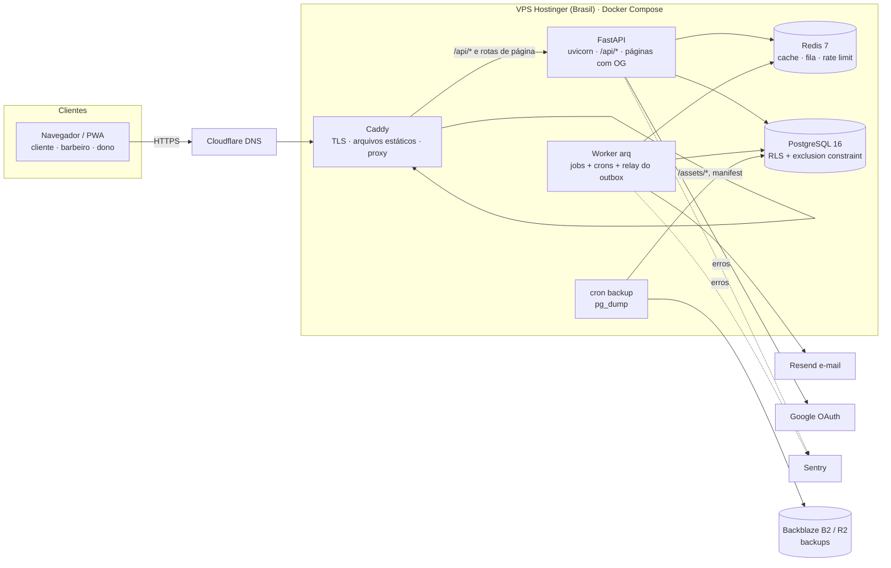

# MVP Design

**Spec**: `.specs/features/mvp/spec.md` · **Context**: `.specs/features/mvp/context.md`
**Status**: Draft (revisão de 2026-11-26: FastAPI + React/Vite, dev solo, VPS Hostinger)
**System design visual**: FigCraft, página "System design" (desatualizada: mostra a stack de 2026-11-22)

---

## Architecture Overview

Monólito modular em FastAPI, com um worker arq em processo separado, ambos na mesma VPS. O site é uma SPA React servida pelo Caddy; as rotas de página passam pelo FastAPI para receber as meta tags de prévia. O banco é a fonte da verdade para concorrência e isolamento. O Redis guarda cache, fila e rate limit, nunca verdade.



### Fluxo crítico: criação de agendamento

```mermaid
sequenceDiagram
  participant C as Navegador
  participant A as FastAPI
  participant DB as PostgreSQL
  participant W as Worker arq
  participant E as Resend
  C->>A: POST /api/barbearias/{id}/agendamentos (cookie de sessão, Idempotency-Key)
  A->>DB: BEGIN; set_config('app.barbearia_id', id, true)
  A->>DB: INSERT agendamento CONFIRMADO ON CONFLICT (barbearia_id, idempotency_key) DO NOTHING
  alt conflito de horário (SQLSTATE 23P01)
    A->>DB: ROLLBACK
    A-->>C: 409 + 3 sugestões
  else ok
    A->>DB: INSERT outbox(agendamento.confirmado); COMMIT
    A->>A: INCR versão do cache de slots (barbeiro, dia)
    A-->>C: 201 {agendamento}
    W->>DB: lê outbox (FOR UPDATE SKIP LOCKED)
    W->>W: enfileira e-mail de confirmação + lembretes (_defer_until início−24h e início−2h)
    W->>E: envia e-mail (até 3 tentativas)
  end
```

### Roteamento no Caddy

| Caminho | Destino | Por quê |
| --- | --- | --- |
| `/api/*` | FastAPI | API |
| `/assets/*`, `/manifest.webmanifest`, `/sw.js`, ícones | arquivos de `frontend/dist` | Arquivos gerados pelo Vite, cache longo |
| qualquer outro caminho | FastAPI (`GET /{path}`) | Devolve `index.html`; em `/{slug}` de barbearia existente injeta `og:title`, `og:description`, `og:image` |

Site e API ficam no mesmo domínio. O cookie de sessão é first-party, sem CORS.

### Repositório

```
barbezy/
├── backend/
│   ├── pyproject.toml          uv: dependências, ruff, mypy, pytest
│   ├── alembic.ini
│   ├── alembic/versions/       migrations (SQL explícito para RLS, roles e exclusion)
│   ├── app/
│   │   ├── main.py             cria o FastAPI, registra routers, Sentry, handlers de erro
│   │   ├── worker.py           WorkerSettings do arq (funções, crons, max_tries)
│   │   ├── core/               config, db (engine/sessão), tenancy, rate_limit, permissoes, erros
│   │   ├── domain/             regras puras sem I/O: slots, estado, atribuicao, politica, metricas
│   │   └── modules/            auth, catalogo, agenda, notificacoes, relatorios, privacidade, public_page
│   │                           cada um com models.py, schemas.py, service.py, router.py
│   └── tests/
│       ├── unit/               domínio, schemas, adapters puros (sem banco)
│       └── integration/        rotas e serviços contra Postgres + Redis reais (testcontainers)
├── frontend/
│   ├── package.json            pnpm
│   ├── vite.config.ts          React + vite-plugin-pwa
│   ├── openapi-ts.config.ts    geração do cliente a partir de /api/openapi.json
│   ├── src/
│   │   ├── api/                cliente gerado (não editar à mão)
│   │   ├── components/ui/      componentes shadcn/ui
│   │   ├── styles/tokens.css   tokens do FigCraft no @theme do Tailwind
│   │   └── features/           publico, agendar, auth, conta, painel
│   └── e2e/                    Playwright
├── learning/                   mini-projetos da Fase 0 (não vão para produção)
├── infra/
│   ├── docker-compose.yml      local: postgres, redis, mailpit
│   ├── docker-compose.prod.yml VPS: caddy, api, worker, redis, postgres, backup
│   ├── Caddyfile
│   └── scripts/                backup.sh, restore-check.sh
├── load/contention.js          k6
├── Makefile                    lint, typecheck, build, test-unit, test-int, test-e2e, gen-api, dev
└── .github/workflows/          ci.yml, deploy.yml
```

`backend/app/domain` é Python puro, sem banco e sem HTTP. Toda regra de negócio mora ali e é testada por unidade. A API é a única autoridade: o site recebe valores já calculados (`cancelavelAte`, `remarcavelAte`, `faixaPreco`) e não recalcula regras.

---

## Code Reuse Analysis

Repositório vazio (greenfield). Reuso vem de bibliotecas:

| Necessidade | Biblioteca | Uso |
| --- | --- | --- |
| API HTTP + OpenAPI | FastAPI | Rotas, injeção de dependências, documentação em `/api/docs` |
| Validação e contratos | Pydantic v2 + pydantic-settings | Schemas de entrada/saída e configuração por variáveis de ambiente |
| Banco | SQLAlchemy 2.0 (async) + asyncpg | Models, sessões, transações |
| Migrations | Alembic | Versionamento do schema; `op.execute` para RLS, roles e `EXCLUDE USING gist` |
| Fila e agendamento de jobs | arq | `enqueue_job(_job_id=..., _defer_until=...)`, `cron()`, `max_tries` |
| Hash de senha | argon2-cffi (argon2id) | Dono e barbeiro |
| TOTP | pyotp | 2FA do dono |
| OAuth Google | Authlib (cliente OIDC para Starlette) | Login social |
| E-mail | SDK `resend` | E-mail transacional; Mailpit no ambiente local |
| Erros | sentry-sdk (integração FastAPI) | API e worker |
| Testes backend | pytest, pytest-asyncio, httpx `AsyncClient`, testcontainers | Unit e integração |
| Qualidade | ruff, mypy | Lint, formatação e tipos |
| Frontend | React, Vite, React Router, TanStack Query, Tailwind CSS, shadcn/ui, vite-plugin-pwa | SPA instalável |
| Cliente da API | `@hey-api/openapi-ts` (plugin TanStack Query) | Tipos e hooks gerados do OpenAPI |
| Testes frontend | Vitest + Testing Library, Playwright | Unit e e2e |

### Integration Points

| Sistema | Método |
| --- | --- |
| Resend | E-mail transacional (OTP, confirmação, lembretes, cancelamento, convite, exportação); domínio com SPF/DKIM |
| Google OAuth | Authorization Code com PKCE via Authlib; callback em `/api/auth/google/callback` |
| Sentry | DSN por variável de ambiente; API e worker |
| Backblaze B2 / Cloudflare R2 | Upload do `pg_dump` diário via API compatível com S3 |
| Cloudflare | Somente DNS (proxy opcional) |

---

## Components

### Tenancy (`backend/app/core/tenancy.py`)
- **Purpose**: Resolver o tenant do request e aplicar isolamento.
- **Interfaces**:
  - Dependência `tenant_session(barbearia_id)`: abre transação e executa `SELECT set_config('app.barbearia_id', :id, true)`. `SET LOCAL` não aceita parâmetro vinculado no asyncpg, por isso `set_config(..., true)`, que tem o mesmo efeito local à transação.
  - Dependência `membro_atual`: valida o vínculo do usuário com a barbearia; responde 404 quando não há vínculo.
- **Roles do banco**: `app_owner` (dono das tabelas, roda migrations), `app_user` (API e worker, sem BYPASSRLS), `app_admin` (crons cross-tenant e admin, com BYPASSRLS, uso auditado). Tabelas de tenant com `FORCE ROW LEVEL SECURITY`.

### Auth (`backend/app/modules/auth`)
- **Purpose**: OTP por e-mail, senha, Google, TOTP, sessões.
- **Interfaces**:
  - `POST /api/auth/otp/request {email}` → 202
  - `POST /api/auth/otp/verify {email, codigo}` → 204 + cookie de sessão
  - `POST /api/auth/senha/login {email, senha}` → 204 + cookie | `{precisaTotp: true}` | `{precisaConfigurarTotp: true}`
  - `POST /api/auth/totp/setup` → `{otpauthUri}` · `POST /api/auth/totp/verify {codigo}`
  - `GET /api/auth/google/login` → redirect · `GET /api/auth/google/callback` → cookie + redirect
  - `POST /api/auth/logout` · `GET /api/me/sessoes` · `DELETE /api/me/sessoes/{id}`
- **Sessão**: token aleatório de 32 bytes no cookie `sessao`; no banco fica só o SHA-256 dele. Dependência `usuario_atual` busca a sessão pelo hash, confere `expira_em` e `revogado_em`.
- **Rate limit**: janela deslizante no Redis por identificador e por IP (`core/rate_limit.py`).

### Catálogo (`backend/app/modules/catalogo`)
- **Purpose**: Barbearia, slug, identidade visual, equipe, convites, jornadas, bloqueios, serviços e overrides.
- **Interfaces**: REST em `/api/barbearias/{id}/{servicos,membros,convites,jornadas,bloqueios}`; `POST /api/barbearias` (onboarding); `PATCH /api/barbearias/{id}/slug`.

### Página pública (`backend/app/modules/public_page`)
- **Purpose**: Dados públicos da barbearia e HTML com prévia.
- **Interfaces**: `GET /api/public/{slug}` (dados da página); `GET /{path}` devolve `frontend/dist/index.html`, com meta tags OG quando `path` é um slug ativo, 301 quando é um slug antigo válido e 404 com "Barbearia não encontrada" quando é um slug inexistente que não é rota do SPA.

### Agenda (`backend/app/modules/agenda`)
- **Purpose**: Slots, criação de agendamento, transições, link assinado, listagens.
- **Interfaces**:
  - `GET /api/public/{slug}/slots?servico=&barbeiro=|qualquer&data=` → `list[Slot]` (cache Redis)
  - `POST /api/barbearias/{id}/agendamentos {servicoId, membroId | "qualquer", inicio}` (header `Idempotency-Key`) → 201 | 409 `{sugestoes}`
  - `POST /api/agendamentos/{id}/{cancelar|remarcar|concluir|no-show}`
  - `GET /api/agendamentos/cancelar?token=` e `POST` correspondente (link assinado HMAC, expira no início)
  - `GET /api/barbearias/{id}/agenda?de=&ate=&membro=` (painel) · `GET /api/me/agendamentos` (cliente)
- **Reuses**: `domain/slots.py`, `domain/estado.py`, `domain/atribuicao.py`, `domain/politica.py`.

### Notificações (`backend/app/modules/notificacoes`)
- **Purpose**: Outbox → arq → e-mail.
- **Interfaces**:
  - Tabela `outbox` gravada na mesma transação do domínio; `relay_outbox` (cron do worker a cada segundo, `FOR UPDATE SKIP LOCKED`) enfileira jobs no arq.
  - Jobs com `_job_id = "{agendamento_id}:{tipo}"` (dedup) e `max_tries = 3`.
  - Lembretes com `_defer_until = inicio − 24h` e `inicio − 2h`; no envio, o job relê o agendamento e só envia se ainda estiver `CONFIRMADO`, no mesmo horário e sem opt-out.
  - `GET /api/lembretes/optout?token=` (link assinado no e-mail).

### Resumo mensal (`backend/app/modules/relatorios`)
- **Interfaces**: `GET /api/barbearias/{id}/resumo?mes=YYYY-MM` → contagem por status, faturamento, taxa de no-show. Barbeiro recebe só os próprios números.
- **Reuses**: `domain/metricas.py`.

### Privacidade (`backend/app/modules/privacidade`)
- **Interfaces**: `POST /api/me/exclusao` (exige OTP), `POST /api/me/exportacao`; crons `lgpd_anonimizar` e `lgpd_retencao`; `registrar_auditoria(acao, alvo, autor, antes, depois)`.

### Frontend (`frontend/src/features`)
- Rotas: `/{slug}` (página pública), `/{slug}/agendar`, `/entrar`, `/conta`, `/cancelar`, `/painel/*`.
- Dados via hooks gerados (`@hey-api/openapi-ts` + TanStack Query). O painel usa `refetchInterval: 30_000`.
- Componentes shadcn/ui pintados com os tokens do FigCraft (`styles/tokens.css`).
- PWA via vite-plugin-pwa: manifest, ícones, service worker só para arquivos estáticos (sem cache de API).

---

## Data Models

Todas as tabelas de tenant têm `barbearia_id` + policy RLS `USING (barbearia_id = current_setting('app.barbearia_id')::uuid)`. Horários em `timestamptz` (UTC). Notação abaixo é a forma dos models SQLAlchemy.

```python
# Identidade (global, sem RLS de tenant)
class Usuario:      id: UUID; nome: str; email: str | None; senha_hash: str | None; totp_secret_enc: str | None
                    opt_out_lembretes: bool; anonimizado_em: datetime | None; criado_em: datetime
class Identidade:   id: UUID; usuario_id: UUID; provedor: Literal["google"]; sub: str        # unique(provedor, sub)
class Sessao:       id: UUID; usuario_id: UUID; token_hash: str; criado_em: datetime; ultimo_uso_em: datetime
                    expira_em: datetime; revogado_em: datetime | None; user_agent: str
class Otp:          id: UUID; email: str; codigo_hash: str; tentativas: int; expira_em: datetime; usado_em: datetime | None

# Tenant
class Barbearia:    id: UUID; slug: str; slug_alterado_em: datetime | None; nome: str; fuso: str
                    logo_url: str | None; capa_url: str | None; cor_destaque: str
                    antecedencia_min_min: int = 120; antecedencia_max_dias: int = 30; janela_remarcacao_min: int = 240
                    suspensa_em: datetime | None
class SlugAntigo:   slug: str; barbearia_id: UUID; valido_ate: datetime
class Membro:       id: UUID; barbearia_id: UUID; usuario_id: UUID; papel: Literal["dono", "barbeiro"]; ativo: bool
class Convite:      id: UUID; barbearia_id: UUID; email: str; token_hash: str; expira_em: datetime; usado_em: datetime | None
class FaixaJornada: id: UUID; barbearia_id: UUID; membro_id: UUID; dia_semana: int; inicio: time; fim: time
class Bloqueio:     id: UUID; barbearia_id: UUID; membro_id: UUID | None; periodo: TSTZRANGE; motivo: str | None
class Servico:      id: UUID; barbearia_id: UUID; nome: str; descricao: str | None
                    categoria: Literal["cabelo", "barba", "combo", "outros"]; duracao_min: int; preco_centavos: int
                    foto_url: str | None; ativo: bool
class ServicoMembro: servico_id: UUID; membro_id: UUID; barbearia_id: UUID; habilitado: bool
                     preco_centavos: int | None; duracao_min: int | None

class Agendamento:  id: UUID; barbearia_id: UUID; cliente_id: UUID | None; membro_id: UUID; servico_id: UUID
                    periodo: TSTZRANGE; preco_centavos: int; duracao_min: int           # congelados
                    status: Literal["CONFIRMADO", "CONCLUIDO", "CANCELADO_CLIENTE", "CANCELADO_BARBEARIA", "NO_SHOW"]
                    forma_pagamento_local: Literal["dinheiro", "pix", "cartao"] | None
                    idempotency_key: str; criado_em: datetime
# EXCLUDE USING gist (membro_id WITH =, periodo WITH &&) WHERE (status IN ('CONFIRMADO','CONCLUIDO','NO_SHOW'))
# UNIQUE (barbearia_id, idempotency_key)

class Outbox:       id: int; barbearia_id: UUID | None; tipo: str; payload: dict; publicado_em: datetime | None
class AuditLog:     id: int; barbearia_id: UUID | None; autor_id: UUID; acao: str; alvo: str
                    antes: dict | None; depois: dict | None; em: datetime
```

**Relationships**: Barbearia 1—N Membro, Servico, Agendamento; Membro N—N Servico via ServicoMembro; Usuario 1—N Membro (papéis acumuláveis).

**Fase 2** adiciona por migration: `PENDENTE_PAGAMENTO` e `EXPIRADO` no status, `hold_expira_em`, tabelas `pagamento`, `assinatura`, `uso_mensal`, `webhook_evento`, colunas Stripe e plano em `barbearia`.

---

## Algoritmos-chave

### Slots (`domain/slots.py`), puro
```
entrada: faixas_do_dia, bloqueios, ocupados (períodos), duracao, fuso, agora, antecedencia_min, antecedencia_max
1. livres = união(faixas do dia local convertidas para UTC) − bloqueios − ocupados
2. para cada t na grade de 15 min dentro de cada intervalo livre:
     se t >= agora + antecedencia_min e t <= fim_do_dia(hoje + antecedencia_max) e [t, t+duracao) ⊆ livre → slot
```
Cache: chave `slots:v{versao(membro,data)}:{membro}:{data}:{duracao}`, TTL 60 s; `INCR` da versão em toda mudança de agenda (NFR-02).

### Criação (concorrência)
1. `tenant_session` abre a transação com o tenant.
2. `INSERT … ON CONFLICT (barbearia_id, idempotency_key) DO NOTHING RETURNING`; se não retornou linha, devolve o agendamento existente com aquela chave (AGD-11).
3. Violação `23P01` (exclusion) → 409 + `sugestoes` (3 próximos slots do mesmo serviço e barbeiro, ou de qualquer barbeiro).

### Máquina de estados (`domain/estado.py`)
Tabela fechada de transições (AGD-09). Toda transição passa por `transicionar(atual, evento)`, que lança `TransicaoInvalida` → 409.

---

## Error Handling Strategy

| Error Scenario | Handling | User Impact |
| --- | --- | --- |
| Conflito de slot (23P01) | 409 + 3 sugestões | "Esse horário acabou de ser reservado" + chips de horários |
| Requisição de criação repetida | Mesmo agendamento pela `Idempotency-Key` | Nenhum (clique duplo não duplica) |
| Transição inválida | 409 `TRANSICAO_INVALIDA` | Toast com o estado atual |
| Cancelar após o início | 409 `FORA_DO_PRAZO` | "Esse atendimento já começou" |
| Remarcar dentro da janela | 409 `FORA_DO_PRAZO` | "Remarcação só até X h antes" |
| E-mail falha | 3 tentativas com backoff; depois registra e alerta no Sentry | Nenhum no agendamento |
| Rate limit | 429 + `Retry-After` | "Muitas tentativas, aguarde X min" |
| Recurso de outro tenant | 404 (nunca 403) | "Não encontrado" |
| Sessão expirada ou revogada | 401 | Redireciona para `/entrar` preservando a página |
| Erro não tratado | 500 genérico + Sentry | "Algo deu errado, tente de novo" |
| Slug inexistente em `/{slug}` | 404 | Página "Barbearia não encontrada" |

---

## Risks & Concerns

| Concern | Location | Impact | Mitigation |
| --- | --- | --- | --- |
| Primeiro contato com FastAPI e login feito à mão | `modules/auth` | Falha de segurança expõe contas | Testes de cada ataque conhecido (força bruta, OTP reutilizado, sessão revogada, fixação de sessão); `/security-review` antes do lançamento (T65) |
| SQLAlchemy assíncrono: carregar relação fora da sessão gera `MissingGreenlet` | todo o backend | Erros confusos para quem está aprendendo | `expire_on_commit=False`, `selectinload` explícito, explicado na Fase 0 (T2) |
| VPS única é ponto único de falha | infra | Queda da VPS derruba o site | `restart: always`, healthchecks, alerta de uptime externo; backup fora da VPS com restauração testada |
| Banco na mesma VPS | infra | Perda de dados se o disco falhar | Backup diário para B2/R2 (T62) + teste de restauração (T63) |
| RLS esquecida em tabela nova | migrations | Vazamento entre tenants | Teste-guardião falha se tabela com `barbearia_id` não tiver policy (T7) |
| Dono das tabelas ignora RLS | banco | RLS sem efeito | API conecta como `app_user`; tabelas com `FORCE ROW LEVEL SECURITY` |
| E-mail cair no spam | notificações | OTP e lembretes não chegam | SPF + DKIM + DMARC no domínio via Resend antes do primeiro envio real (T10) |
| PWA no iPhone tem limitações (instalação manual, push restrito) | frontend | Experiência pior no iOS | Aceito no MVP; app Expo na fase 2 |
| Cliente gerado desatualizado | frontend | Tipos divergentes da API | `make gen-api` no CI falha se houver diff (T9) |

---

## Tech Decisions (only non-obvious ones)

| Decision | Choice | Rationale |
| --- | --- | --- |
| Unicidade de horário | Exclusion constraint GiST em `(membro_id, periodo)` filtrada por status ocupante | Garantia no banco sob qualquer concorrência (NFR-01) |
| Tenant por transação | `set_config('app.barbearia_id', id, true)` | Equivale a `SET LOCAL` e aceita parâmetro no asyncpg |
| Eventos de domínio | Transactional outbox + arq | E-mail nunca é perdido nem enviado sem commit |
| Sessão | Registro no banco + cookie httpOnly | Mesmo domínio; revogação trivial; mais simples que JWT |
| Prévia do link | FastAPI injeta OG no `index.html` | Prévia no WhatsApp sem servidor Node |
| Regras de negócio | Só no backend | Uma implementação, um conjunto de testes |
| Monólito modular | FastAPI único + worker arq | Uma pessoa, uma VPS; módulos por domínio permitem extrair depois |
| Infra | VPS Hostinger + Cloudflare DNS | Decisão do usuário (D15) |

Project-level → STATE.md AD-001..AD-012.
