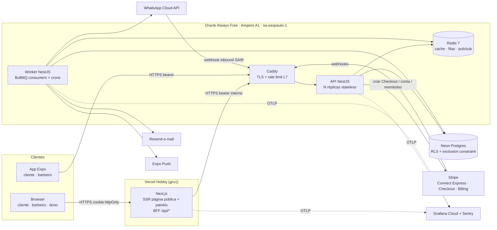

# MVP Design

**Spec**: `.specs/features/mvp/spec.md` · **Context**: `.specs/features/mvp/context.md`
**Status**: Draft
**System design visual**: FigCraft, página "System design"

---

## Architecture Overview

Monólito modular (NestJS) com workers separados por processo, BFF no Next.js, app Expo falando direto com a API, tudo em infra gratuita (D15). O banco é a fonte da verdade para concorrência e isolamento; Redis é cache, fila e pub/sub, nunca verdade.



### Fluxo crítico: agendamento com pagamento online

```mermaid
sequenceDiagram
  participant C as Cliente
  participant N as Next BFF
  participant A as API
  participant DB as Postgres
  participant Q as BullMQ
  participant S as Stripe
  C->>N: confirmar slot
  N->>A: POST /barbearias/:id/agendamentos (Idempotency-Key)
  A->>DB: BEGIN; SET LOCAL app.barbearia_id; expira holds vencidos do barbeiro/dia
  A->>DB: INSERT agendamento PENDENTE_PAGAMENTO (exclusion constraint)
  alt conflito (23P01)
    A-->>N: 409 + 3 sugestões
  else ok
    A->>DB: INSERT outbox(hold.criado) ; COMMIT
    A->>S: checkout.sessions.create (conta conectada)
    A-->>N: 201 {checkoutUrl}
    Q->>Q: job hold.expirar com delay 10 min
    C->>S: paga
    S->>A: webhook checkout.session.completed
    A->>DB: INSERT webhook_evento (PK = event.id) ; UPDATE → CONFIRMADO ; outbox(agendamento.confirmado)
  end
  Q->>A: hold.expirar → se ainda PENDENTE: EXPIRADO + checkout.sessions.expire
```

### Monorepo

```
barber-app/
├── apps/
│   ├── web/        Next.js (App Router) — página pública, fluxo do cliente, painéis, BFF
│   ├── mobile/     Expo (expo-router) — cliente + barbeiro
│   └── api/        NestJS — main.ts (HTTP) e worker.ts (filas/crons), mesmo código
├── packages/
│   ├── contracts/  Zod schemas + tipos + cliente HTTP gerado (web, mobile, api)
│   ├── db/         Drizzle schema, migrations SQL, policies RLS, seeds
│   ├── domain/     Regras puras: slots, máquina de estados, política de cancelamento, comissão, limites de plano
│   ├── ui/         Design system: tokens (cores, tipografia, espaçamento) + componentes web; tokens também consumidos pelo mobile
│   └── config/     tsconfig, eslint, vitest base
├── infra/
│   ├── docker-compose.yml        local (postgres, redis, api, worker, stripe-cli, mailpit)
│   ├── docker-compose.prod.yml   VM (caddy, api×2, worker, redis)
│   └── Caddyfile
├── load/           k6 (browse.js, booking.js, contention.js)
└── .github/workflows/  ci.yml, deploy-api.yml, eas.yml
```

`packages/domain` é TypeScript puro, sem I/O: é onde mora toda regra de negócio testável por unidade e reaproveitável no app (ex.: exibir faixa de preço, checar janela de cancelamento offline).

---

## Code Reuse Analysis

Repositório vazio (greenfield). Reuso é entre pacotes do monorepo e bibliotecas:

| Componente | Origem | Uso |
| --- | --- | --- |
| Validação e contratos | `packages/contracts` (Zod) | API valida entrada; web e mobile tipam respostas; zero duplicação |
| Regras de negócio | `packages/domain` | API (autoridade) + web/mobile (UX: faixa de preço, janelas) |
| Tokens de design | `packages/ui/tokens` | Next (CSS vars) e Expo (objeto TS), espelham o "Design system" do FigCraft |
| Fila e agendamento de jobs | BullMQ | holds, lembretes, notificações, downgrade, anonimização |
| Auth TOTP | `otplib` | 2FA do dono |
| Hash de senha | `argon2` (argon2id) | Dono/barbeiro |
| OAuth Google/Apple | `openid-client` (API) + `expo-auth-session` / `expo-apple-authentication` | Login social |

### Integration Points

| Sistema | Método |
| --- | --- |
| Stripe Connect | Contas Express + Account Links; Checkout Sessions na conta conectada; Refunds; webhooks Connect |
| Stripe Billing | Products/Prices por plano; Checkout em modo subscription; Customer Portal para cartão; webhooks `customer.subscription.*`, `invoice.payment_failed` |
| WhatsApp Cloud API | Templates `auth_code` (authentication) e `agendamento_*` (utility); webhook de mensagens recebidas para "SAIR" |
| Resend | E-mail transacional (OTP, confirmações, recibos internos, exportação) |
| Expo Push | Push para barbeiro |
| Neon | Postgres via pooler (pgbouncer) para a API; conexão direta para migrations |

---

## Components

### Tenancy (`apps/api/src/tenancy`) — Mateus
- **Purpose**: Resolver o tenant do request e aplicar isolamento.
- **Interfaces**:
  - `TenantGuard` — resolve `barbearia_id` por rota (`/barbearias/:id`) ou slug (`/public/:slug`), valida vínculo do usuário, 404 quando não vinculado.
  - `withTenant<T>(barbeariaId, fn: (tx) => Promise<T>)` — abre transação e executa `SET LOCAL app.barbearia_id = $1`.
- **Dependencies**: `packages/db`.
- **Reuses**: policies RLS de `packages/db/rls.sql`.

### Auth (`apps/api/src/auth`) — Mateus
- **Purpose**: OTP (WhatsApp/e-mail), senha, Google/Apple, TOTP, sessões.
- **Interfaces**:
  - `POST /auth/otp/request {canal, destino}` → 202
  - `POST /auth/otp/verify {destino, codigo}` → tokens
  - `POST /auth/password/login {email, senha}` → tokens | `{precisaTotp}`
  - `POST /auth/totp/setup` / `POST /auth/totp/verify`
  - `POST /auth/oauth/{google|apple}` → tokens
  - `POST /auth/refresh` (rotação + detecção de reuso por família)
  - `GET /me/sessoes`, `DELETE /me/sessoes/:id`
- **Dependencies**: Redis (rate limit sliding window), fila `notificacoes` (envio do OTP).

### Catálogo (`apps/api/src/catalogo`) — Mauricio
- **Purpose**: Barbearia, slug, identidade visual, equipe, convites, jornadas, bloqueios, serviços e overrides.
- **Interfaces**: CRUD REST em `/barbearias/:id/{servicos,membros,convites,jornadas,bloqueios}`; `GET /public/:slug`.

### Agenda (`apps/api/src/agenda`) — Mauricio
- **Purpose**: Slots, criação de agendamento, transições de estado, cancelamento/remarcação/no-show.
- **Interfaces**:
  - `GET /public/:slug/slots?servico=&barbeiro=|qualquer&data=` → `Slot[]` (cache Redis)
  - `POST /barbearias/:id/agendamentos {servicoId, membroId|qualquer, inicio, forma: 'agora'|'local'}` (header `Idempotency-Key`) → 201 | 409 `{sugestoes}` | 403 `{limitePlano}` | 422 `FORMA_NAO_PERMITIDA`
  - `formasPermitidas(barbearia, cliente)` em `packages/domain/formas-pagamento.ts`: `so_local` → `['local']`; `cliente_escolhe` → `['agora','local']`, ou `['agora']` se o cliente tem 2 no-shows em 90 dias. A API recusa com 422 qualquer `forma` fora da lista; a UI usa a mesma função.
  - `POST /agendamentos/:id/{cancelar|remarcar|concluir|no-show}`
  - `GET /agendamentos/cancelar?token=` (link assinado HMAC, expira no início)
- **Reuses**: `packages/domain/slots`, `packages/domain/estado`, `packages/domain/politica-cancelamento`.

### Pagamentos (`apps/api/src/pagamentos`) — Lorenzo
- **Purpose**: Connect onboarding, Checkout do agendamento, reembolso, webhooks, disputas.
- **Interfaces**:
  - `POST /barbearias/:id/stripe/conectar` → URL do Account Link
  - `PaymentGateway` (porta): `criarCheckout(ag)`, `expirarCheckout(id)`, `reembolsar(pagamentoId)`, `contaPronta(contaId)` — implementação `StripeGateway`. A porta existe para trocar de gateway caso Pix seja bloqueante (ver Risks).
  - `POST /webhooks/stripe` — verifica assinatura, grava `webhook_evento` (PK `event.id`, `ON CONFLICT DO NOTHING`), despacha handler na mesma transação.

### Planos (`apps/api/src/planos`) — Lorenzo
- **Purpose**: Assinatura, limites, contagem mensal, carência, downgrade.
- **Interfaces**:
  - `PlanoPolicy.podeCriarAgendamento(barbeariaId, inicio)` — conta mensal com `SELECT … FOR UPDATE` na linha `uso_mensal` (serializa a 20ª vaga).
  - `PlanoPolicy.podeAtivarBarbeiro(barbeariaId)`
  - Jobs: `plano.carencia-expirar`, `plano.escolha-barbeiros-expirar` (48 h).

### Notificações (`apps/api/src/notificacoes`) — Mateus
- **Purpose**: Outbox → filas → WhatsApp/e-mail/push/SSE.
- **Interfaces**:
  - Tabela `outbox` gravada na transação de domínio; `OutboxRelay` (worker, a cada 1 s, `FOR UPDATE SKIP LOCKED`) publica em BullMQ.
  - Fila `notificacoes` (3 tentativas, backoff exponencial) com `jobId = {agendamentoId}:{tipo}` para dedup.
  - Lembretes: jobs com delay `inicio − 24h` e `inicio − 2h`; no envio, revalida status `CONFIRMADO` e opt-out.
  - `GET /barbearias/:id/eventos` (SSE) via Redis pub/sub canal `tenant:{id}`.
  - `POST /webhooks/whatsapp` (verificação de assinatura `X-Hub-Signature-256`) para "SAIR".

### Relatórios (`apps/api/src/relatorios`) — Lorenzo
- **Purpose**: Agregações de faturamento, no-show, ocupação, ranking, comissão; CSV no Plus.
- **Interfaces**: `GET /barbearias/:id/relatorios?de=&ate=&barbeiro=&servico=`; `GET …/relatorios.csv`.
- **Reuses**: `packages/domain/comissao`, `packages/domain/metricas`.

### Privacidade (`apps/api/src/privacidade`) — Mateus
- **Purpose**: Exclusão, exportação, retenção, audit log.
- **Interfaces**: `POST /me/exclusao` (com OTP), `POST /me/exportacao`; crons `lgpd.anonimizar`, `lgpd.retencao`; `AuditService.registrar(acao, alvo, autor)`.

### Web (`apps/web`) — Mauricio (público/cliente) · Lorenzo (planos/relatórios/Stripe) · Mateus (auth/conta)
- Rotas: `/{slug}` (SSR, ISR 60 s para dados estáticos da barbearia; slots buscados no cliente), `/{slug}/agendar`, `/entrar`, `/conta`, `/painel/*`.
- BFF: `app/api/[...path]/route.ts` repassa ao API com bearer interno; cookies httpOnly `SameSite=Lax` no domínio do Next. Resolve cookie cross-site (web na Vercel, API na VM).

### Mobile (`apps/mobile`) — Mauricio
- Stack expo-router com grupos `(cliente)` e `(barbeiro)`; tokens em `expo-secure-store`; deep link `https://app/{slug}` e `barberapp://`.
- Pagamento: abre Checkout com `expo-web-browser` e retorna por deep link; tela de retorno faz polling do status (até 30 s).

---

## Data Models

Todas as tabelas de tenant têm `barbearia_id` + policy RLS `USING (barbearia_id = current_setting('app.barbearia_id')::uuid)`. Horários em `timestamptz` (UTC).

```typescript
// Identidade (global, sem RLS de tenant)
interface Usuario { id: uuid; nome: string; email?: string; telefone?: string; senhaHash?: string; totpSecretEnc?: string; canalPreferido: 'whatsapp'|'email'; optOutLembretes: boolean; anonimizadoEm?: Date; criadoEm: Date }
interface Identidade { id: uuid; usuarioId: uuid; provedor: 'google'|'apple'; sub: string }            // unique(provedor, sub)
interface Sessao { id: uuid; usuarioId: uuid; familia: uuid; refreshHash: string; rotacionadoEm?: Date; revogadoEm?: Date; expiraEm: Date; userAgent: string }
interface Otp { id: uuid; destino: string; codigoHash: string; tentativas: number; expiraEm: Date; usadoEm?: Date }

// Tenant
interface Barbearia { id: uuid; slug: string; slugAlteradoEm?: Date; nome: string; fuso: string; logoUrl?: string; capaUrl?: string; corDestaque: string;
  modoPagamento: 'so_local'|'cliente_escolhe'; antecedenciaMinMin: number /*120*/; antecedenciaMaxDias: number /*30*/; janelaCancelamentoMin: number /*240*/;
  stripeContaId?: string; stripeCobrancasHabilitadas: boolean; pixHabilitado: boolean; plano: 'free'|'pro'|'plus'; carenciaAte?: Date; encerradaEm?: Date }
interface SlugAntigo { slug: string; barbeariaId: uuid; validoAte: Date }
interface Membro { id: uuid; barbeariaId: uuid; usuarioId: uuid; papel: 'dono'|'barbeiro'; ativo: boolean; comissaoPct: number; pushToken?: string }
interface Convite { id: uuid; barbeariaId: uuid; email: string; tokenHash: string; expiraEm: Date; usadoEm?: Date }
interface FaixaJornada { id: uuid; barbeariaId: uuid; membroId: uuid; diaSemana: 0|1|2|3|4|5|6; inicio: 'HH:mm'; fim: 'HH:mm' }  // intervalos = lacunas entre faixas
interface Bloqueio { id: uuid; barbeariaId: uuid; membroId?: uuid /* null = casa toda */; periodo: tstzrange; motivo?: string }
interface Servico { id: uuid; barbeariaId: uuid; nome: string; descricao?: string; categoria: 'cabelo'|'barba'|'combo'|'outros'; duracaoMin: number; precoCentavos: number; fotoUrl?: string; ativo: boolean }
interface ServicoMembro { servicoId: uuid; membroId: uuid; barbeariaId: uuid; habilitado: boolean; precoCentavos?: number; duracaoMin?: number }

interface Agendamento { id: uuid; barbeariaId: uuid; clienteId?: uuid /* null após anonimização */; membroId: uuid; servicoId: uuid;
  periodo: tstzrange; precoCentavos: number; duracaoMin: number;                      // congelados
  status: 'PENDENTE_PAGAMENTO'|'CONFIRMADO'|'CONCLUIDO'|'CANCELADO_CLIENTE'|'CANCELADO_BARBEARIA'|'NO_SHOW'|'EXPIRADO';
  modoPagamento: 'local'|'online'; formaPagamentoLocal?: 'dinheiro'|'pix'|'cartao'; holdExpiraEm?: Date; idempotencyKey: string; criadoEm: Date }
// EXCLUDE USING gist (membro_id WITH =, periodo WITH &&)
//   WHERE (status IN ('PENDENTE_PAGAMENTO','CONFIRMADO','CONCLUIDO','NO_SHOW'))
// UNIQUE (barbearia_id, idempotency_key)

interface Pagamento { id: uuid; barbeariaId: uuid; agendamentoId: uuid; stripeCheckoutId: string; stripePaymentIntentId?: string; valorCentavos: number;
  status: 'PENDENTE'|'PAGO'|'REEMBOLSO_SOLICITADO'|'REEMBOLSADO'|'FALHOU'|'CONTESTADO' }
interface Assinatura { barbeariaId: uuid; stripeCustomerId: string; stripeSubscriptionId?: string; plano: 'pro'|'plus'; status: string; periodoAte: Date }
interface UsoMensal { barbeariaId: uuid; mes: 'YYYY-MM'; agendamentos: number; aviso80Em?: Date; aviso100Em?: Date }  // PK(barbearia_id, mes)
interface WebhookEvento { id: string /* event.id */; fonte: 'stripe'|'whatsapp'; tipo: string; recebidoEm: Date; processadoEm?: Date }
interface Outbox { id: bigserial; barbeariaId?: uuid; tipo: string; payload: jsonb; publicadoEm?: Date }
interface AuditLog { id: bigserial; barbeariaId?: uuid; autorId: uuid; acao: string; alvo: string; antes?: jsonb; depois?: jsonb; em: Date }
```

**Relationships**: Barbearia 1—N Membro, Servico, Agendamento; Membro N—N Servico via ServicoMembro; Agendamento 1—0..1 Pagamento; Usuario 1—N Membro (papéis acumuláveis).

**No-show recorrente (CAN-09)**: consulta `count(*) WHERE cliente_id=? AND barbearia_id=? AND status='NO_SHOW' AND periodo >= now()-90d` no momento da criação; índice parcial cobre.

---

## Algoritmos-chave

### Slots (packages/domain/slots) — puro
```
entrada: faixasDoDia[], bloqueios[], ocupados[] (períodos), duracao, fuso, agora, antecedenciaMin, antecedenciaMax
1. livres = união(faixas no dia local convertidas p/ UTC) − bloqueios − ocupados
2. para cada t em grade 15 min dentro de cada intervalo livre:
     se t >= agora+antecedenciaMin && t <= fimDoDia(hoje+antecedenciaMax) && [t, t+duracao) ⊆ livre → slot
```
Cache: chave `slots:v{versao(membro,data)}:{membro}:{data}:{duracao}` TTL 60 s; `INCR versao` em toda mudança (NFR-04).

### Criação (concorrência)
1. `withTenant` → `UPDATE agendamento SET status='EXPIRADO' WHERE membro_id=$m AND status='PENDENTE_PAGAMENTO' AND hold_expira_em < now()` (limpa holds vencidos antes de disputar, sem depender do sweeper).
2. `PlanoPolicy.podeCriarAgendamento` (lock na linha `uso_mensal`).
3. `INSERT … ON CONFLICT (barbearia_id, idempotency_key) DO NOTHING RETURNING` → retry idempotente devolve o mesmo agendamento.
4. Violação `23P01` (exclusion) → 409 + `sugestoes` (3 próximos slots do mesmo serviço/barbeiro ou qualquer).

### Máquina de estados (packages/domain/estado)
Tabela fechada de transições (AGD-13); toda transição passa por `transicionar(atual, evento)` que lança `TransicaoInvalida` → 409.

---

## Error Handling Strategy

| Error Scenario | Handling | User Impact |
| --- | --- | --- |
| Conflito de slot (23P01) | 409 + 3 sugestões | "Esse horário acabou de ser reservado" + chips de horários |
| Limite Free atingido | 403 `LIMITE_PLANO` | Página: "Agenda indisponível online" |
| Stripe indisponível ao criar Checkout | Agendamento → `EXPIRADO`, 503 | "Pagamento indisponível, tente novamente" |
| Pagamento chega após `EXPIRADO` | Reembolso automático + notificação | E-mail "Seu pagamento foi estornado" |
| Forma de pagamento não permitida (ex.: "local" para cliente com 2 faltas, "agora" em barbearia só no local) | 422 `FORMA_NAO_PERMITIDA` | UI já esconde a opção; erro só em chamada direta |
| Conta Stripe perde `charges_enabled` | Webhook `account.updated` muda a barbearia para `so_local` + alerta ao dono | Novos agendamentos só no local; os já pagos seguem normais |
| Webhook duplicado | `ON CONFLICT DO NOTHING` em `webhook_evento` | Nenhum |
| Webhook assinatura inválida | 400, log de segurança | Nenhum |
| WhatsApp falha (OTP) | Retorno `canalFalhou` | Botão "Receber por e-mail" |
| Notificação falha 3x | Dead-letter + métrica | Nenhum no agendamento |
| Transição inválida | 409 `TRANSICAO_INVALIDA` | Toast com estado atual |
| Rate limit | 429 + `Retry-After` | "Muitas tentativas, aguarde X min" |
| Recurso de outro tenant | 404 (nunca 403) | "Não encontrado" |
| Neon acordando (cold start) | Retry de conexão 1x com 2 s | Latência maior no 1º request após ociosidade |

---

## Risks & Concerns

| Concern | Location (file:line) | Impact | Mitigation |
| --- | --- | --- | --- |
| Oracle Always Free: relatos de 2026 de limite A1 reduzido (4→2 OCPU / 24→12 GB) e "out of capacity" | infra (n/a — greenfield) | VM pode não ser criada ou ter menos recurso | Dimensionar compose para 2 OCPU/12 GB; criar a VM na semana 1 (T2); plano B: Koyeb/Render free para API + Upstash só para cache (fila em Postgres via pg-boss) |
| Vercel Hobby é para uso não-comercial | apps/web | Violação de termos quando houver receita | Gatilho de migração no rollout (1ª barbearia pagante → Vercel Pro ou Next self-hosted na VM) |
| Pix é invite-only para contas no Brasil no Stripe | pagamentos | Pix indisponível no MVP | Feature flag por barbearia (PAG-11) + porta `PaymentGateway` para trocar de gateway se Pix virar bloqueante |
| Cobrança direta vs. destination charge em conta Express (quem paga a taxa e quem responde por saldo negativo) | pagamentos | Taxa Stripe cair na plataforma ou responsabilidade por saldo negativo | Spike T38 lê a doc atual de Connect charges e decide antes de codar; registrar em AD |
| Checkout Session tem expiração mínima maior que 10 min | pagamentos | Hold de 10 min não casa com expires_at do Checkout | Expirar ativamente via API `checkout.sessions.expire` no job `hold.expirar`; pagamento tardio → reembolso (PAG-05) |
| Verificação Meta / aprovação de templates leva dias | notificações | Login e lembretes WhatsApp atrasam | Iniciar no dia 1 (T3); e-mail cobre OTP enquanto isso |
| Neon Free escala a zero (cold start) | db | p95 piora após ociosidade | Aceito no free tier; metas NFR provadas em compose local; migração por gatilho |
| VM única = ponto único de falha vs 99,5% | infra | Queda da VM derruba API | `restart: always`, healthcheck do Caddy, alerta Grafana; 2ª instância quando sair do free tier. Meta de 99,5% vale após migração; no free tier é monitorada, não garantida |
| BullMQ com Redis na mesma VM perde jobs se o disco/VM cair | worker | Lembrete atrasado/perdido | Redis com AOF; outbox no Postgres permite republicar; sweeper de holds a cada 60 s como rede de segurança |
| RLS esquecida em tabela nova | db | Vazamento entre tenants | Teste de integração que falha se qualquer tabela com `barbearia_id` não tem policy (T6) |

---

## Tech Decisions (only non-obvious ones)

| Decision | Choice | Rationale |
| --- | --- | --- |
| Unicidade de horário | Exclusion constraint GiST em `(membro_id, periodo)` filtrada por status ocupante | Garantia no banco sob qualquer concorrência; NFR-01 |
| Expiração de hold | Limpeza inline no INSERT + job atrasado + sweeper | Exclusion não aceita `now()`; inline garante corretude, job/sweeper liberam slots ociosos |
| Contagem do Free | Linha `uso_mensal` com `FOR UPDATE` | Serializa só a barbearia, não a tabela; evita 21º agendamento |
| Eventos de domínio | Transactional outbox | Notificação nunca é perdida nem enviada sem commit |
| Web ↔ API | Next.js como BFF | Cookies httpOnly no domínio da Vercel; API na VM sem CORS de credenciais |
| Auth | Implementação própria no NestJS | Custo zero; requisitos (OTP WhatsApp, TOTP obrigatório por papel) fogem do free tier de IdPs |
| Monólito modular | NestJS único, 2 entrypoints | 3 devs, 1 VM; módulos por domínio permitem extrair serviço depois |
| Infra | Vercel + Oracle VM + Neon | Pedido "0800" (D15) |

Project-level → STATE.md AD-001..AD-006.
